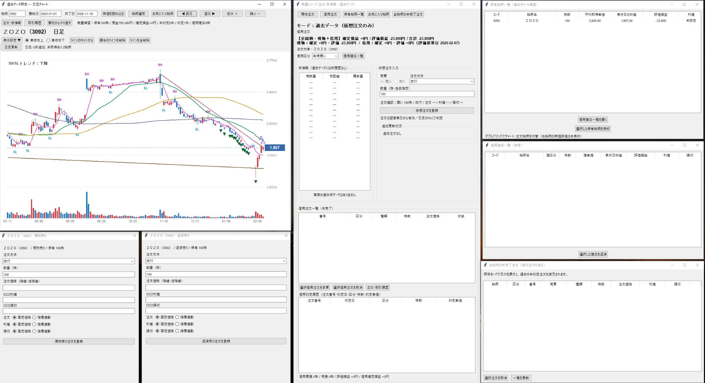

# Trade Station | Python製 裁量ハイブリッド株式トレーディングシステム

> **就職活動向けポートフォリオ** — 独自の売買アルゴリズムと実運用コードは非公開です。

## プロジェクト概要

日本株を対象に、裁量判断と注文処理の自動化を組み合わせるデスクトップアプリケーションを個人開発しています。過去約20年分の株価データを用いた売買シミュレーションに加え、リアルタイム市場データを用いるペーパートレードと実取引を目指し、チャート分析・注文管理・証券会社API連携を一つのGUIに統合しています。裁量ハイブリッド機能はほぼ完成しており、リアルタイム機能は開発・動作検証を進めています。

## 主な機能

- **チャート表示**：ローソク足、移動平均線、ボリンジャーバンドなどのテクニカル指標
- **独自の可視化**：独自に考案した「大チャネルライン」「ブレイクマーカー」をチャート上に表示（計算ロジック・判定条件は非公開）
- **SH/SL（スイングハイ／スイングロー）**：相場の局所的な高値・安値をチャート上に可視化し、値動きの構造を把握
- **指標追従型の注文機能（設計・実装状況に応じて検証中）**：移動平均線、ボリンジャーバンド、SH/SL、大チャネルラインなどを参照し、利確・損切りの注文価格を相場に応じて追従させる仕組み。固定価格による注文方式との併用を想定
- **研究モード**：過去約20年分の株価データを使って疑似売買。過去の相場を進めたり戻したりしながら、注文・約定・損益の変化を繰り返し検証
- **デモモード**：同じく過去約20年分の株価データを使って疑似売買。未来の値動きを見ずに日付を進め、巻き戻しなしで注文・約定・保有状況を確認
- **リアルタイムペーパートレードモード（開発・検証中）**：リアルタイムの市場データを利用し、実資金を使わずに売買判断や注文処理を検証するモード
- **リアルタイムトレードモード（開発・検証中）**：証券会社APIと連携し、実際の市場で裁量判断と注文処理の自動化を組み合わせるモード。API経由の実注文・約定は成功済み
- **注文・口座管理**：現物・信用取引に関する注文、建玉、約定履歴、損益の管理
- **データ永続化**：SQLiteによる状態保存と再読込
- **外部連携**：証券会社APIによる実注文の送信と約定に成功（リアルタイム取引機能全体の完成を意味するものではありません）

## 使用技術

Python / デスクトップGUI / SQLite / 株価データ処理 / 証券会社API / Git・GitHub / 自動テスト

## 公開コードサンプル

本リポジトリでは、実際のシステム設計を参考に、機密情報や独自売買アルゴリズムを除いたPythonの実装サンプルを公開しています。

### SQLiteによる状態管理

- [state_store.py](code_samples/state_store.py)：SQLiteとJSONを利用したアプリケーション状態の保存・復元
- [test_state_store.py](tests/test_state_store.py)：pytestによる保存・復元、モード間の独立性、データ更新のテスト

研究モードとデモモードの状態を個別に管理する仕組みを、独立したサンプルとして再構成しています。

※公開コードはポートフォリオ向けの簡略版であり、実運用システムのソースコードそのものではありません。

### 注文入力のバリデーション

- [order_validation.py](code_samples/order_validation.py)：銘柄コード、注文数量、注文種別、指値価格の入力検証
- [test_order_validation.py](tests/test_order_validation.py)：pytestによる正常系・異常系のテスト

成行注文と指値注文に対応した入力検証を、独立したサンプルとして実装しています。型変換、条件分岐、例外処理を組み合わせ、不正な入力を検出します。

※証券会社APIへの発注や独自売買アルゴリズムは含まれていません。

## 開発で担当したこと

本システムは、本人が全体構想・機能発案・仕様設計を主導し、生成AIを実装支援に活用して開発しています。

### 本人が発案・設計した機能

- **大チャネルライン**：相場の大きなトレンドを可視化する独自機能
- **SH/SLの活用・可視化**：スイングハイ・スイングローによる相場構造の表示
- **ブレイクマーカー**：チャネルライン突破を視覚的に捉える独自機能
- **指標追従型の利確・損切り注文**：テクニカル指標に応じて注文価格を追従させる仕組み（開発・検証中）

### 開発プロセスで担当したこと

- システム全体の構想、要件定義、仕様策定
- GUIの操作設計と改善方針の決定
- 生成AIを活用したコード実装・修正の指示
- 売買シナリオに沿った動作検証、不具合の切り分け
- 注文処理やデータ保存・復元の検証

※ChatGPTやCodexなどの生成AIを実装支援に利用しています。独自機能のアイデアと仕様設計は本人によるものです。

## 画面紹介

### モード選択画面

*起動時に、過去データ研究・過去データデモ・リアルタイムペーパー・リアルタイム実戦の4モードから選択できます。リアルタイム機能は開発・検証中です。*

### 研究モードのチャート・注文画面

*過去約20年分の株価データを利用できる研究モードの画面例。チャート、現物・信用注文入力、保有銘柄・建玉・注文一覧を一画面に配置しています。画像は収益性能を示すものではありません。*

### 銘柄選定・一括分析画面

*ROE・ROAで抽出した候補銘柄を株価データベースと照合し、移動平均線、トレンド方向、チャネル内の株価位置、三角持ち合いの状態を一括分析します。画面には候補175件・株価DB登録159件・分析完了157件の実行例を表示しています。*

## 独自機能と公開範囲について

本システムは、独自に考案した「大チャネルライン」「ブレイクマーカー」に加え、SH/SL（スイングハイ／スイングロー）による相場分析・可視化機能を備えています。さらに、テクニカル指標に追従する利確・損切り注文の仕組みを開発・検証対象としています。チャート分析、注文管理、売買シミュレーション、データベース保存、証券会社API連携を組み合わせた個人開発プロジェクトです。

独自技術・知的財産および認証情報を保護するため、売買戦略、各種計算アルゴリズム、判定条件、実取引コード、口座情報、取引履歴、価格データベースは非公開です。公開するのは画面と機能概要に限定しています。

## 今後の開発目標

本プロジェクトの最終目標は、**日本株の完全自動売買システムの構築**です。

現在開発している裁量ハイブリッド売買システムを基盤として、段階的に自動化を進める方針です。

1. **裁量ハイブリッド売買**：独自チャート分析機能と指標追従型注文を組み合わせ、人間の判断と注文処理の自動化を融合
2. **リアルタイム検証**：実際の市場データを用いたペーパートレードで、売買ロジックや注文処理を検証
3. **ルールベースの完全自動売買**：売買判断から発注、利確、損切りまでをプログラムで自動実行
4. **AI・機械学習の活用**：十分な検証結果を得た段階で、相場環境への適応や売買判断の高度化を検討

過去約20年分の株価データによるバックテストとリアルタイムペーパートレードを活用し、売買戦略の有効性、リスク管理、システムの安定性を検証しながら開発を進めます。

なお、完全自動売買機能は将来の開発目標であり、現時点で完成した機能ではありません。

**本リポジトリは、就職活動における開発実績の紹介を目的としています。**

## 補足

本プロジェクトは個人の技術学習・開発成果を紹介するものです。投資助言や売買システムの配布を目的としません。
