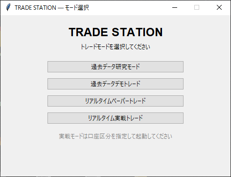
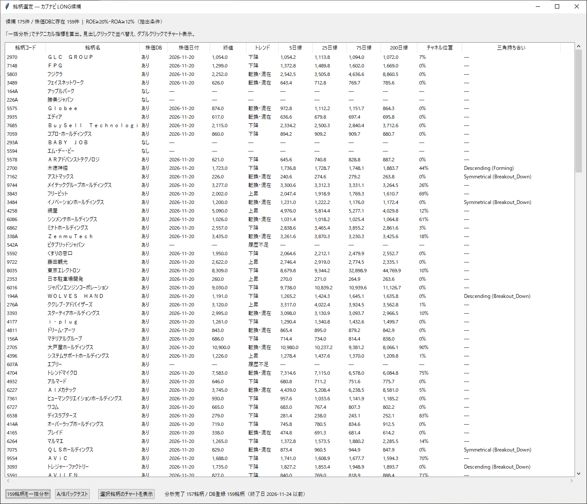

# Trade Station | Python製 裁量ハイブリッド株式トレーディングシステム

> **就職活動向け開発ポートフォリオ**  
> 日本株のチャート分析・銘柄選定・売買シミュレーション・注文管理・証券会社API連携を統合した個人開発プロジェクトです。独自の売買アルゴリズムおよび実運用コードは公開していません。

## プロジェクト概要

日本株を対象に、裁量による売買判断と注文処理の自動化を組み合わせるPython製デスクトップアプリケーション「Trade Station」を開発しています。

過去約20年分の株価データを用いる研究・デモ機能、複数銘柄の一括分析、チャート上でのトレンド可視化、現物・信用注文の管理に加え、**三菱UFJ eスマート証券のkabuステーションAPIとの連携**を実装しています。

開発の中心は、個別機能を作るだけでなく、**銘柄選定 → チャート分析 → 注文入力 → 注文・約定照会 → 保有・建玉管理**を一連の画面操作で扱えるようにすることです。

生成AI（ChatGPT・Codex等）を実装支援に活用しながら、本人が構想・要件定義・仕様決定・動作確認・不具合の切り分けを主導しています。

## 主な機能

### 1. 銘柄選定・一括分析

- ROE・ROAなどの財務条件で抽出した候補銘柄のCSVを読み込み、SQLiteの株価データベースと照合
- 複数銘柄に対し、5日・25日・75日・200日移動平均線、トレンド方向、チャネル内の株価位置を一括算出
- 三角持ち合いのパターン・形成／ブレイク状況を一覧表示
- 列ごとの並べ替え、個別チャートへの遷移、2種類の買い戦略の探索的バックテスト

画面例では、**候補175件・株価DB登録159件・一括分析完了157件**を表示しています。ROE・ROAによる候補抽出そのものは外部の抽出結果を入力として利用します。

### 2. チャート分析・テクニカル指標

- ローソク足チャート（日足・週足）、移動平均線、ボリンジャーバンド
- RSI、MACD、ストキャスティクス、ATR、DMI・ADX、一目均衡表などの表示切り替え
- SH/SL（スイングハイ／スイングロー）の検出・可視化
- 独自の**大チャネルライン・中チャネルライン**、ブレイクマーカー
- 三角持ち合いの状態判定
- **フィボナッチ・リトレースメントの自動描画**（確定済みスイングを基準に、23.6%・38.2%・50%・61.8%・78.6%などを表示）
- チャートの拡大・縮小、スクロール、手動ライン描画

独自ラインの算出ロジック、パターン判定の詳細条件は非公開です。チャート上の表示は、特定の売買戦略の収益性を保証するものではありません。

### 3. 研究・デモ・リアルタイム取引モード

| モード | 役割 |
| --- | --- |
| 過去データ研究 | 過去の値動きを進めたり戻したりしながら売買を試行し、注文・損益を検証 |
| 過去データデモ | 将来の株価を見ず、巻き戻しなしで日付を進める裁量売買練習 |
| リアルタイムペーパー | リアルタイム市場データによる仮想注文・検証（開発・検証中） |
| リアルタイム実戦 | 証券会社APIを用いた実口座の注文・照会（機能ごとに検証中） |

研究・デモの取引状態はSQLiteで保存・復元し、注文・約定履歴や現物／信用の保有状態を管理します。

### 4. 注文・約定・口座管理

- 現物買い・売り、信用新規買い・売り、信用返済の注文操作
- 成行・指値・逆指値およびIFD／OCO／IFD-OCO形式の注文条件を扱う画面・ロジック
- 注文前確認、数量・価格等の入力検証
- 未完了注文、約定履歴、保有銘柄、信用建玉、返済可能数量の表示
- 注文の取消・変更や、部分約定・残数量を考慮した処理の実装・検証

**API経由の実注文・約定、信用売建と返済の成功実績があります。** 一方、複合注文や価格追従を含む実口座での一連の動作確認は継続中です。仮想売買で使用できる注文方式と、証券会社APIでの実発注・連携処理の提供状況は区別しています。

### 5. 指標連動型の注文機能

固定価格のほか、移動平均線、ボリンジャーバンド、SH/SL、大・中チャネルラインなどの算出価格を注文条件に反映する仕組みを実装しています。

利確・損切り等の価格に対して指標の選択、呼値単位の調整、自動追従の設定を行い、更新状況を管理します。実口座向けIFD／OCO／IFD-OCO連携も実装していますが、**実資金を用いた複合注文の総合検証は進行中**です。

## 画面紹介

### モード選択画面



*研究・デモ・リアルタイムペーパー・リアルタイム実戦の4モードを選択します。*

### 研究モードのチャート・注文画面


*チャート分析、注文入力、保有・建玉・注文管理を統合した画面例。画像は収益性能を示すものではありません。*

### 銘柄選定・一括分析画面



*財務条件から抽出した候補を株価DBと照合し、トレンド・移動平均線・チャネル位置・三角持ち合い等を一括分析。画面例では候補175件・DB登録159件・分析完了157件を表示しています。*

## 使用技術と開発で扱った領域

| 技術・領域 | 活用内容 |
| --- | --- |
| Python | データ処理、分析・検証ロジック、GUIとAPI処理の統合 |
| Tkinter / ttk | デスクトップGUI、各種一覧・注文入力・ダイアログ |
| SQLite / SQL | 株価データ照会、売買シミュレーション状態の保存・復元 |
| 証券会社API | kabuステーションAPIによる市場・注文・口座情報の取得と注文送信 |
| CSV / JSON | 候補銘柄の取り込み、設定・状態データの取り扱い |
| pytest | 注文入力や状態管理などの自動テスト |
| Git / GitHub | バージョン管理、機能別ブランチ、公開ポートフォリオ管理 |

## 公開コードサンプル

実システムの機密情報や独自売買ロジックを含まないよう、**学習・採用評価向けに独立して再構成したサンプル**を公開しています。

### SQLiteによる状態管理

- [state_store.py](code_samples/state_store.py)：SQLite・JSONを用いた状態保存と復元
- [test_state_store.py](tests/test_state_store.py)：保存・復元、モード分離、更新処理に関するpytestテスト

### 注文入力のバリデーション

- [order_validation.py](code_samples/order_validation.py)：銘柄コード・数量・注文種別・価格の入力検証
- [test_order_validation.py](tests/test_order_validation.py)：正常系・異常系のpytestテスト

### 候補銘柄の一括データ分析

- [candidate_analysis.py](code_samples/candidate_analysis.py)：CSVの重複除去、SQLite照会、過去の確定株価による移動平均線算出
- [test_candidate_analysis.py](tests/test_candidate_analysis.py)：CSV異常系、履歴不足、未来データの除外、欠損値のテスト

独自の銘柄選定・チャネル判定ロジックは含めず、データ処理部分を独立したサンプルとして再構成しています。

### APIレスポンスの整形・検証

- [api_response_normalization.py](code_samples/api_response_normalization.py)：架空の建玉応答をGUI表示用に正規化、数量の整合性を検証
- [test_api_response_normalization.py](tests/test_api_response_normalization.py)：買建・売建、拘束数量、入力異常系のテスト

架空データのみを利用し、実口座情報、認証処理、発注API通信は含みません。

**テスト実行方法**（リポジトリのルートで実行）

```bash
python -m pytest -q --basetemp=.pytest_tmp
```

Windows環境で **24件すべてのテストに成功（24 passed / 0.33秒、2026年11月24日）**。既定の一時フォルダにアクセス制限がある環境でも実行できるよう、テスト用一時フォルダをプロジェクト内に指定しています。`.pytest_tmp` はpytestが再作成するテスト専用ディレクトリです。

公開サンプルは実運用ソースの複製ではなく、設計上の考え方とPython実装の一部を示すものです。

## 本人の担当範囲・開発プロセス

- **構想・要件定義**：裁量判断と注文処理の自動化を組み合わせる全体設計
- **機能設計**：大・中チャネル、SH/SL、ブレイク表示、指標連動注文、モード別の取引フロー
- **GUI設計・改善**：画面構成、操作手順、注文前確認、一覧表示と画面間連携
- **実装支援の活用**：生成AIへの仕様提示、修正指示、差分確認とGit管理
- **テスト・検証**：研究／デモの動作検証、実口座の注文・返済試行、不具合の再現と原因切り分け

ChatGPTやCodex等をコード実装・レビューの支援に利用しています。**AI生成コードを無検証のまま完成扱いせず、機能単位で実行・確認して改善する方針**です。

## 開発状況と今後の目標

| 領域 | 現在の状況 |
| --- | --- |
| 過去データ研究・デモ、チャート描画 | 実装済み・継続改善 |
| 銘柄選定・一括分析 | 実装済み |
| フィボナッチ自動描画 | 実装済み（機能別ブランチで保存） |
| APIでの実注文・約定、信用新規・返済 | 成功実績あり |
| 実口座の複合注文・指標追従 | 実装済み・実売買検証中 |
| ルールベースの完全自動売買 | 将来の開発目標 |
| AI・機械学習による高度化 | 将来の検討課題 |

まずは実戦で使える裁量ハイブリッド機能の安全性と安定性を優先し、実測結果をもとに段階的に改善します。十分な検証後に、売買判断から発注・利確・損切りまでを行うルールベースの完全自動売買を目指します。

## 公開範囲と注意事項

本リポジトリは**就職活動における個人開発実績の紹介**を目的としています。

独自の売買戦略・各種計算アルゴリズム・判定条件、認証情報、口座情報、実取引履歴、株価データベース、および実運用の注文処理コードは非公開です。

掲載画像・機能説明・コードサンプルは、投資収益や実運用の安全性を保証するものではありません。投資助言や売買システムの配布を目的としません。
